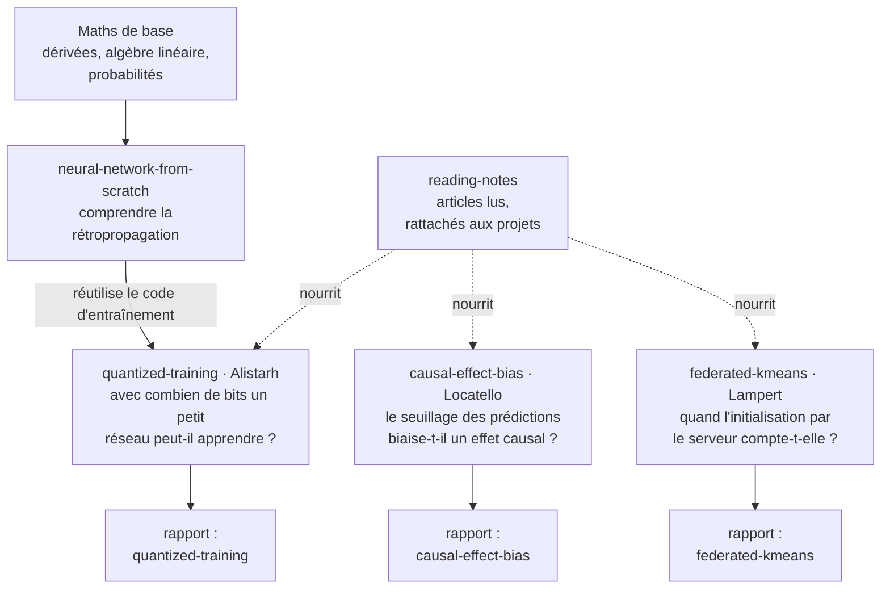

[English](README.md) | **Français**

# Computer Science & AI — Portfolio de recherche

Portfolio orienté recherche d'un étudiant de L3 Informatique (Université de Reims Champagne-Ardenne), construit pour candidater à un stage de recherche en apprentissage automatique.

## Objectif

Montrer, à l'échelle d'un étudiant de licence, une capacité à :

- comprendre les fondements mathématiques et algorithmiques ;
- implémenter des méthodes sans dépendre entièrement de bibliothèques haut niveau ;
- lire un article de recherche récent et en reproduire une idée à petite échelle ;
- poser une question précise et concevoir une expérience contrôlée ;
- analyser des résultats en distinguant observation, interprétation et conclusion ;
- documenter un travail reproductible, limites comprises.

Tous les projets tournent sur un ordinateur portable (**CPU uniquement**).

---

## Graphe du portfolio



## Projets

| Projet | Question | Article | Statut |
|---|---|---|---|
| [neural-network-from-scratch](neural-network-from-scratch/README.fr.md) | Construire et vérifier un réseau de neurones en NumPy | — (base technique) | En cours |
| [causal-effect-bias](causal-effect-bias/README.fr.md) | Le biais dû au seuillage des prédictions change-t-il quand le traitement est déséquilibré ? | Cadei et al., NeurIPS 2024 | À démarrer |
| [federated-kmeans](federated-kmeans/README.fr.md) | Avec du bruit de confidentialité, quand un petit jeu de données sur le serveur fait-il fonctionner un k-means fédéré ? | Scott, Lampert et Saulpic, ICML 2025 | À démarrer |
| [quantized-training](quantized-training/README.fr.md) | Une transformation de Hadamard rend-elle plus précis l'entraînement en basse précision d'un petit réseau ? | Panferov et al. (QuEST), 2025 | À démarrer |

Chaque README de projet donne la question, la méthode, une **première action** de 30 minutes et une Definition of Done.

## Arborescence

```text
.
├── README.md / README.fr.md
├── ROADMAP.md / ROADMAP.fr.md
├── requirements.txt
├── .gitignore
│
├── neural-network-from-scratch/
│   ├── README.md / README.fr.md
│   ├── neuron.py
│   ├── catdogneuron.py
│   ├── utilities.py
│   └── datasets/
│
├── causal-effect-bias/          README.md / README.fr.md
├── federated-kmeans/            README.md / README.fr.md
├── quantized-training/          README.md / README.fr.md
│
├── research-notes/
│   ├── README.md / README.fr.md
│   ├── smoke-and-mirrors.md
│   ├── feddp-kmeans.md
│   ├── quest.md
│   └── sparse-pruning.md
│
└── report/
    └── research-report.md
```

Les dossiers `src/`, `tests/`, `experiments/` et `results/` sont créés **au moment où ils deviennent nécessaires**. Aucun fichier vide ou placeholder n'est ajouté uniquement pour faire apparaître une arborescence.

## Installation

```bash
python -m venv .venv
# Windows : .venv\Scripts\activate    —    Linux/macOS : source .venv/bin/activate
pip install -r requirements.txt
```

## Definition of Done

Un projet est terminé lorsqu'il possède :

- une question et des hypothèses écrites **avant** les résultats ;
- une implémentation lisible, avec des tests sur des cas calculables à la main ;
- des expériences répétées sur plusieurs graines ;
- des résultats sauvegardés et des figures ;
- une section « limites » honnête ;
- un README qui permet à quiconque de tout reproduire.
