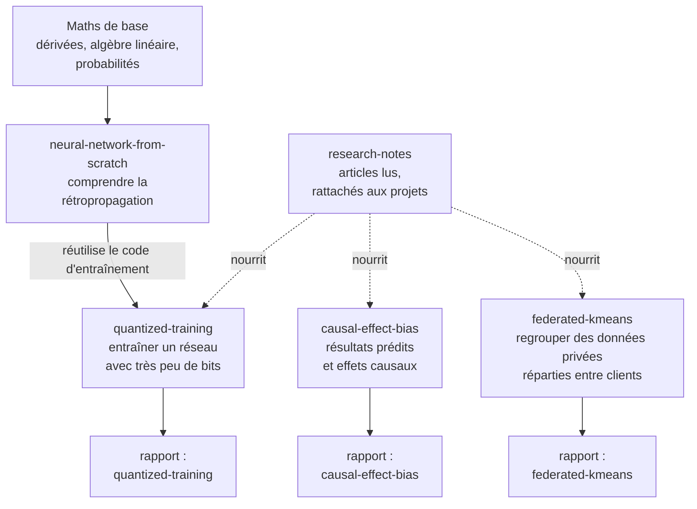

[English](README.md) | **Français**

# Computer Science & AI — Portfolio de recherche

Portfolio orienté recherche d'un étudiant de L3 Informatique (Université de Reims Champagne-Ardenne), construit pour préparer un stage de recherche en apprentissage automatique.

## Objectif

Chaque projet part d'un article de recherche récent, en reproduit une idée à petite échelle et pose une question précise à son sujet. Le but est de s'exercer, à un niveau licence, à :

- comprendre les fondements mathématiques et algorithmiques d'une méthode ;
- l'implémenter sans dépendre entièrement de bibliothèques haut niveau ;
- concevoir des expériences contrôlées, répétées sur plusieurs graines aléatoires ;
- distinguer observation, interprétation et conclusion ;
- documenter un travail reproductible, limites comprises.

Tous les projets tournent sur un ordinateur portable (**CPU uniquement**).

## Graphe du portfolio



## Projets

| Projet | Question | Article de départ |
|---|---|---|
| [neural-network-from-scratch](neural-network-from-scratch/README.fr.md) | Comment un réseau de neurones apprend-il, écrit à partir des principes de base en NumPy ? | — (base technique) |
| [causal-effect-bias](causal-effect-bias/README.fr.md) | Comment le déséquilibre du traitement affecte-t-il les estimations d'effet causal calculées à partir des prédictions d'un classifieur ? | Cadei et al., *Smoke and Mirrors in Causal Downstream Tasks*, NeurIPS 2024 |
| [federated-kmeans](federated-kmeans/README.fr.md) | Avec un bruit ajouté pour protéger la confidentialité, quand un petit jeu de données sur le serveur fait-il fonctionner un k-means fédéré ? | Scott, Lampert et Saulpic, *Differentially Private Federated k-Means Clustering with Server-Side Data*, ICML 2025 |
| [quantized-training](quantized-training/README.fr.md) | Une transformation de Hadamard avant la quantification aide-t-elle un petit réseau à apprendre avec très peu de bits ? | Panferov et al., *QuEST: Stable Training of LLMs with 1-Bit Weights and Activations*, 2025 |

## Organisation du dépôt

Chaque projet a son propre dossier et son propre README. Le code, les tests, les expériences et les résultats sont ajoutés au dossier d'un projet au fil du travail. Les notes de lecture sont dans [`research-notes/`](research-notes/README.fr.md).

## Installation

```bash
python -m venv .venv
# Windows : .venv\Scripts\activate    —    Linux/macOS : source .venv/bin/activate
pip install -r requirements.txt
```

## Règles de travail

Toutes les études de ce dépôt suivent les mêmes règles :

- la question et les hypothèses sont écrites et commitées **avant** les résultats ;
- les implémentations sont testées sur des cas calculables à la main ;
- les expériences sont répétées sur plusieurs graines et présentées avec leur dispersion ;
- les conclusions se limitent à ce que les expériences soutiennent, et les limites sont écrites explicitement ;
- les résultats sont reproductibles à partir du README du projet.
