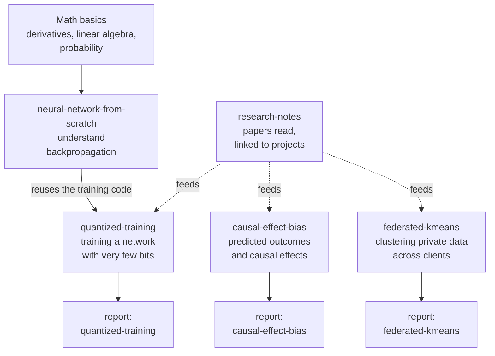

**English** | [Français](README.fr.md)

# Computer Science & AI — Research Portfolio

Research-oriented portfolio of a third-year Computer Science undergraduate (Licence 3 Informatique, Université de Reims Champagne-Ardenne), built to prepare for a research internship in machine learning.

## Purpose

Each project starts from a recent research paper, reproduces one of its ideas at small scale, and asks a precise question about it. The aim is to practise, at undergraduate level:

- understanding the mathematical and algorithmic foundations of a method;
- implementing it without relying entirely on high-level libraries;
- designing controlled experiments, repeated over several random seeds;
- separating observation, interpretation and conclusion;
- documenting reproducible work, limitations included.

Every project runs on a laptop (**CPU only**).

## Portfolio map



## Projects

| Project | Question | Starting paper |
|---|---|---|
| [neural-network-from-scratch](neural-network-from-scratch/) | How does a neural network learn, written from first principles in NumPy? | — (technical foundation) |
| [causal-effect-bias](causal-effect-bias/) | How does treatment imbalance affect causal-effect estimates computed from a classifier's predictions? | Cadei et al., *Smoke and Mirrors in Causal Downstream Tasks*, NeurIPS 2024 |
| [federated-kmeans](federated-kmeans/) | Under noise added to protect privacy, when does a small server-side dataset make federated k-means work? | Scott, Lampert & Saulpic, *Differentially Private Federated k-Means Clustering with Server-Side Data*, ICML 2025 |
| [quantized-training](quantized-training/) | Does a Hadamard transform before quantization help a small network train with very few bits? | Panferov et al., *QuEST: Stable Training of LLMs with 1-Bit Weights and Activations*, 2025 |

## Repository structure

Each project lives in its own folder with its own README. Code, tests, experiments and results are added to a project folder as the work progresses. Reading notes are in [`research-notes/`](research-notes/).

## Installation

```bash
python -m venv .venv
# Windows: .venv\Scripts\activate    —    Linux/macOS: source .venv/bin/activate
pip install -r requirements.txt
```

## Working standards

Every study in this repository follows the same rules:

- the question and hypotheses are written and committed **before** the results;
- implementations are tested on cases that can be computed by hand;
- experiments are repeated over several random seeds and reported with their spread;
- conclusions are limited to what the experiments support, and limitations are stated explicitly;
- results can be reproduced from the project README.
