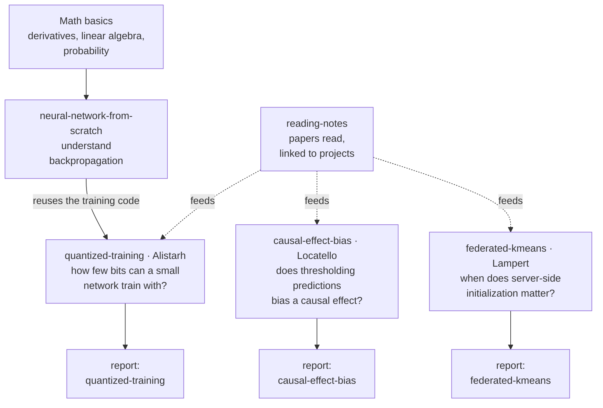

**English** | [Français](README.fr.md)

# Computer Science & AI — Research Portfolio

Research-oriented portfolio of a third-year Computer Science undergraduate (Licence 3 Informatique, Université de Reims Champagne-Ardenne), built to apply for a research internship in machine learning.

## Goal

Show, at the scale of an undergraduate student, the ability to:

- understand the mathematical and algorithmic foundations;
- implement methods without relying entirely on high-level libraries;
- read a recent research paper and reproduce one of its ideas at small scale;
- ask a precise question and design a controlled experiment;
- analyse results while separating observation, interpretation and conclusion;
- document reproducible work, limitations included.

Every project runs on a laptop (**CPU only**).

---

## Portfolio map



## Projects

| Project | Question | Paper | Status |
|---|---|---|---|
| [neural-network-from-scratch](neural-network-from-scratch/) | Build and verify a neural network in NumPy | — (technical foundation) | In progress |
| [causal-effect-bias](causal-effect-bias/) | Does the bias caused by thresholding predictions change when the treatment is imbalanced? | Cadei et al., NeurIPS 2024 | Not started |
| [federated-kmeans](federated-kmeans/) | Under privacy noise, when does a small server-side dataset make federated k-means work? | Scott, Lampert & Saulpic, ICML 2025 | Not started |
| [quantized-training](quantized-training/) | Does a Hadamard transform make low-bit training of a small network more accurate? | Panferov et al. (QuEST), 2025 | Not started |

Each project README gives the question, the method, a 30-minute **first step**, and a Definition of Done.

## Repository layout

```text
.
├── README.md / README.fr.md
├── ROADMAP.md / ROADMAP.fr.md
├── requirements.txt
├── .gitignore
│
├── neural-network-from-scratch/
│   ├── README.md / README.fr.md
│   ├── neuron.py
│   ├── catdogneuron.py
│   ├── utilities.py
│   └── datasets/
│
├── causal-effect-bias/          README.md / README.fr.md
├── federated-kmeans/            README.md / README.fr.md
├── quantized-training/          README.md / README.fr.md
│
├── research-notes/
│   ├── README.md / README.fr.md
│   ├── smoke-and-mirrors.md
│   ├── feddp-kmeans.md
│   ├── quest.md
│   └── sparse-pruning.md
│
└── report/
    └── research-report.md
```

`src/`, `tests/`, `experiments/` and `results/` folders are created **when they become necessary**. No empty file or placeholder is added just to display a structure.

## Installation

```bash
python -m venv .venv
# Windows: .venv\Scripts\activate    —    Linux/macOS: source .venv/bin/activate
pip install -r requirements.txt
```

## Definition of Done

A project is finished when it has:

- a question and hypotheses written **before** the results;
- a readable implementation, with tests on cases that can be computed by hand;
- experiments repeated over several random seeds;
- saved results and figures;
- an honest limitations section;
- a README that lets anyone reproduce everything.
